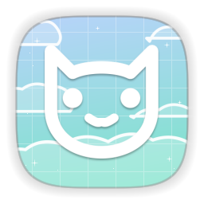
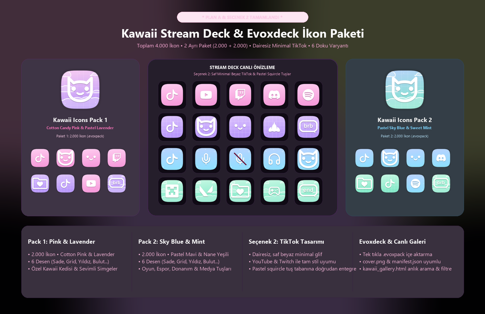
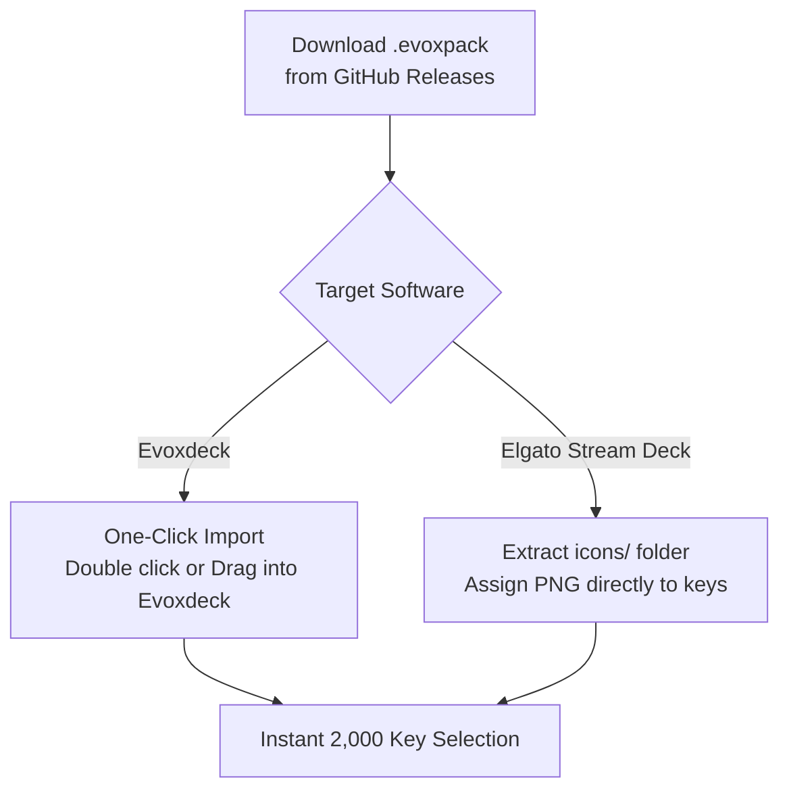

  
  <h1>Kawaii Icons Pack 2</h1>
  
<strong>2,000 Refreshing Pastel Stream Deck & Evoxdeck Squircle Icons (Pastel Sky Blue & Sweet Mint).</strong>

  

    <strong>Language:</strong> <a href="README.md"><strong>EN</strong></a> | <a href="README.tr.md"><strong>TR</strong></a>
    &nbsp;•&nbsp;
    <a href="https://github.com/Hfatih/kawaii-icons-pack-2/releases/latest">Download .evoxpack</a> ·
    <a href="https://hfatih.github.io/kawaii-icons-pack-2/">Live Interactive Gallery</a> ·
    <a href="#how-to-install">How to Install</a>
  

  

    
    
    
    
    
    
  

  

    
    
    
    
    
  

---

## Overview

**Kawaii Icons Pack 2** is an ultra-high-definition, refreshing pastel icon collection crafted specifically for **Elgato Stream Deck**, **Evoxdeck**, **Loupedeck**, and **Touch Portal**.

Rendered with precision superellipse ($p=4.0, r=54$) squircles at Retina $128\times 128$ resolution, combining airy pastel sky blue and refreshing sweet mint gradients with 6 delightful anime texture patterns.

### 🌐 Live Interactive Web Gallery
You can preview, search, filter and experience all 2,000 icons directly in your web browser:
👉 **[Open Live Gallery on GitHub Pages](https://hfatih.github.io/kawaii-icons-pack-2/)**

---

## Showcase

| Stream Deck Live Mockup & Key Matrix |
| :---: |
|  |
| *2,000 icons across Pastel Sky Blue & Sweet Mint tiles featuring clean solid white glyphs, custom kawaii cat badges, and wine-red mute slashes.* |

---

## Color Palettes & Swatches

| Theme Name | Slug | Top-Left RGB | Bottom-Right RGB | Hex Gradient |
| :--- | :--- | :--- | :--- | :--- |
| **Pastel Sky Blue** | `sky-blue` | `rgb(205, 235, 255)` | `rgb(145, 195, 255)` | `#cdebff` ➔ `#91c3ff` |
| **Sweet Mint** | `sweet-mint` | `rgb(205, 252, 235)` | `rgb(125, 225, 195)` | `#cdfcb` ➔ `#7de1c3` |

---

## 6 Pattern Variants

Every symbol is available in 6 distinct aesthetic patterns:

1. **Sade (Plain):** Smooth, clean pastel diagonal glass gradient.
2. **Izgara (Grid):** Geometric 18px cute planner grid pattern (0.32 alpha).
3. **Yıldızlar (Stars ✦):** 4-point sparkle anime cross stars and twinkling stardust.
4. **Bulutlar (Clouds):** Floating anime fluffy white cloud silhouettes.
5. **Izgara + Yıldız (Grid & Stars):** Coordinated planner grid adorned with celestial sparkles.
6. **Bulut + Yıldız (Clouds & Stars):** Floating anime clouds with sparkling stardust.

---

## Curated Symbol Categories (166 Glyphs × 12 Themes)

1. **🐱 Kawaii & Customs:** Kawaii Cat, Kawaii Smile, Lotus Petals, Heart Folder, BRB Badge, END Badge, Monitor Snow/Sun/Plus/Minus, Hearts, Sparkles.
2. **📱 Social & Creator Platforms:** TikTok (clean minimalist white glyph), YouTube, Twitch, Discord, Instagram, Twitter/X, Facebook, Spotify, Steam, Kick, Reddit, Telegram, WhatsApp, Snapchat, GitHub, Patreon, OBS Studio, Streamlabs, Audacity, Blender.
3. **🎙️ Audio & Voice Controls:** Mic, Headphones, Volume (0-1-2-Mute), Bell, Soundlines, Waveforms. Muted/Off states feature an elegant wine-red (`#691237`) diagonal slash.
4. **🎵 Media & Music:** Play, Pause, Skip, Rewind, Shuffle, Repeat, Disc, Radio, Podcast, Guitar, Camera, Video, FL Studio, Apple Music.
5. **⭐ Streamer Badges:** REC, LIVE, Game Audio, Music Audio, Mute, Deaf, Mic On, GG, VIP, MOD, Clutch, AFK, Hype, Sub, Chat, Poll, Clip, Trophy, Crown, Flame, Zap.
6. **🎮 Gaming & Esports:** Minecraft (Creeper Head Block), Valorant (official Riot V), League of Legends (official crest), PlayStation, Xbox, Nintendo Switch, Roblox, Gamepad, Joystick, Swords, Battle Axe, Bomb, Crosshair, Dices.
7. **⚙️ System & Hardware:** CPU, GPU, RAM, Monitor, Laptop, Mouse, Keyboard, WiFi, Bluetooth, Clock, Timer, Power, Lock, Settings.

---

## How to Install

### 1. Evoxdeck (Recommended)
1. Download `Kawaii Icons Pack 2.evoxpack` from [Releases](https://github.com/Hfatih/kawaii-icons-pack-2/releases/latest).
2. Double-click the file or open **Evoxdeck** ➔ **Settings** ➔ **Icon Packs** ➔ **Import Pack**.
3. All 2,000 icons and categories will appear instantly in your Evoxdeck library.

### 2. Elgato Stream Deck
1. Extract `icons/` folder from the repository or `.evoxpack`.
2. In the Elgato Stream Deck configuration software, drag and drop any PNG onto a key slot.

---

## Package Specification (`manifest.json`)

- `schemaVersion`: `1`
- `packageType`: `icon_pack`
- `coverImage`: `cover.png` (256×256 Retina squircle)
- `assets/icons/`: 2,000 individual PNG icons ($128\times 128$ px, 32-bit RGBA)

---

## License

Distributed under the **MIT License**. Free for personal and commercial stream setups.
Authored with 💖 by **[Fatih Han](https://github.com/Hfatih)**.
