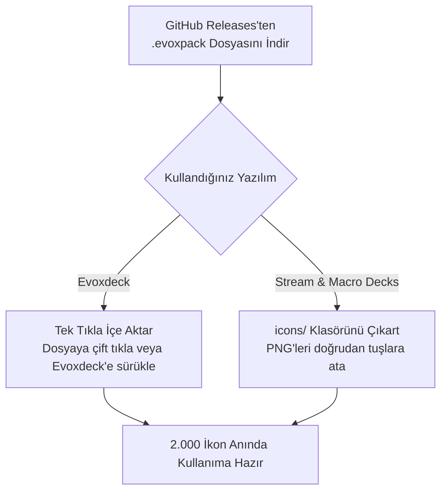

  
  <h1>Kawaii Icons Pack 2</h1>
  
<strong>2.000 Adet Ferah Pastel Stream Deck & Evoxdeck İkon Paketi (Pastel Sky Blue & Sweet Mint).</strong>

  

    <strong>Dil:</strong> <a href="README.md"><strong>EN</strong></a> | <a href="README.tr.md"><strong>TR</strong></a>
    &nbsp;•&nbsp;
    <a href="https://github.com/Hfatih/kawaii-icons-pack-2/releases/latest">.evoxpack İndir</a> ·
    <a href="https://hfatih.github.io/kawaii-icons-pack-2/">Canlı Web Galerisi</a> ·
    <a href="#kurulum">Nasıl Kurulur?</a>
  

  

    
    
    
    
    
    
  

  

    
    
    
    
    
  

---

## Genel Bakış

**Kawaii Icons Pack 2**, **Stream & Macro Decks**, **Evoxdeck**, **Loupedeck** ve **Touch Portal** cihazları için özel olarak tasarlanmış, ferahlatıcı açık mavi ve nane yeşili pastel tonlarında estetik bir ikon koleksiyonudur.

Her ikon, Retina $128\times 128$ çözünürlükte, süperelips ($p=4.0, r=54$) squircle taban üzerinde, zengin pastel cam gradyanlar ve 6 farklı anime tarzı doku varyantıyla hazırlanmıştır.

### 🌐 Canlı Web Deneyimi & Galeri
Hiçbir dosya indirmeden 2.000 ikonun tamamını doğrudan tarayıcınızda arayabilir, filtreleyebilir ve inceleyebilirsiniz:
👉 **[GitHub Pages Üzerinde Galeriyi Aç](https://hfatih.github.io/kawaii-icons-pack-2/)**

---

## Vitrin & Önizleme

| Stream Deck Canlı Tuş Dizilimi |
| :---: |
|  |
| *Pastel Sky Blue ve Sweet Mint tuşlar üzerinde saf beyaz minimalist glifler, özel sevimli kedi rozetleri ve vişne kırmızısı mute çizgileri.* |

---

## Renk Paletleri

| Tema Adı | Kod | Sol-Üst RGB | Sağ-Alt RGB | Hex Gradyan |
| :--- | :--- | :--- | :--- | :--- |
| **Pastel Sky Blue** | `sky-blue` | `rgb(205, 235, 255)` | `rgb(145, 195, 255)` | `#cdebff` ➔ `#91c3ff` |
| **Sweet Mint** | `sweet-mint` | `rgb(205, 252, 235)` | `rgb(125, 225, 195)` | `#cdfcb` ➔ `#7de1c3` |

---

## 6 Doku Varyantı

Paketteki her sembol 6 farklı doku seçeneğiyle sunulur:

1. **Sade (Plain):** Pürüzsüz, ferah geçişli pastel cam gradyan.
2. **Izgara (Grid):** 18px sevimli ajanda ızgara çizgileri (%32 şeffaflık).
3. **Yıldızlar (Stars ✦):** 4 köşeli anime ışıltı yıldızları ve göksel yıldız tozu.
4. **Bulutlar (Clouds):** Havada süzülen sevimli beyaz anime bulut silüetleri.
5. **Izgara + Yıldız (Grid & Stars):** Izgara deseni ve ışıltılı yıldızların uyumu.
6. **Bulut + Yıldız (Clouds & Stars):** Bulutlar ve parıldayan yıldız tozu kombinasyonu.

---

## Kategoriler (166 Sembol × 12 Tema)

1. **🐱 Kawaii & Özel Simgeler:** Kawaii Kedi, Kawaii Gülümseme, Nilüfer Çiçeği, Kalpli Klasör, BRB (Hemen Döneceğim) Rozeti, END Rozeti, Monitör Soğutma/Güneş/Eksi/Artı, Kalpler, Işıltılar.
2. **📱 Sosyal Medya & Platformlar:** TikTok (dairesiz saf beyaz minimal glif), YouTube, Twitch, Discord, Instagram, Twitter/X, Facebook, Spotify, Steam, Kick, Reddit, Telegram, WhatsApp, Snapchat, GitHub, OBS Studio, Streamlabs, Audacity, Blender.
3. **🎙️ Ses & Mikrofon Kontrolleri:** Mikrofon, Kulaklık, Ses Seviyeleri (0-1-2-Mute), Bildirim Zili, Dalga Boyu Grafikleri. Kapalı durumlarda vişne kırmızısı (`#691237`) zarif çapraz çizgi.
4. **🎵 Medya & Müzik:** Oynat, Duraklat, İleri, Geri, Karıştır, Tekrarla, Plak, Radyo, Podcast, Gitar, Kamera, Video, FL Studio, Apple Music.
5. **⭐ Yayıncı Rozetleri:** REC, LIVE, Game Audio, Music Audio, Mute, Deaf, Mic On, GG, VIP, MOD, Clutch, AFK, Hype, Sub, Chat, Poll, Clip, Kupa, Taç, Alev, Şimşek.
6. **🎮 Oyun & Espor:** Minecraft (Creeper Kafa Bloğu), Valorant (resmi Riot V glifi), League of Legends (resmi arma), PlayStation, Xbox, Nintendo Switch, Roblox, Gamepad, Joystick, Çift Kılıç, Savaş Baltası, Bomba, Nişangah, Zarlar.
7. **⚙️ Sistem & Donanım:** CPU, GPU, RAM Bellek, Monitör, Laptop, Mouse, Klavye, WiFi, Bluetooth, Saat, Zamanlayıcı, Güç, Kilit, Ayarlar.

---

## Kurulum

### 1. Evoxdeck (Önerilen)
1. [Releases](https://github.com/Hfatih/kawaii-icons-pack-2/releases/latest) sayfasından `Kawaii Icons Pack 2.evoxpack` dosyasını indirin.
2. Dosyaya çift tıklayın veya **Evoxdeck** ➔ **Ayarlar** ➔ **İkon Paketleri** ➔ **Paket İçe Aktar** yolunu izleyin.
3. 2.000 ikon anında kütüphanenize yüklenir.

### 2. Stream & Macro Decks
1. Depodaki `icons/` klasörünü açın.
2. Stream & Macro Decks yazılımında istediğiniz PNG dosyasını tuş yuvasına sürükleyip bırakın.

---

## Lisans

**MIT Lisansı** altında sunulmaktadır. Kişisel ve ticari yayınlarda serbestçe kullanılabilir.
💖 **[Fatih Han](https://github.com/Hfatih)** tarafından sevgiyle hazırlandı.
